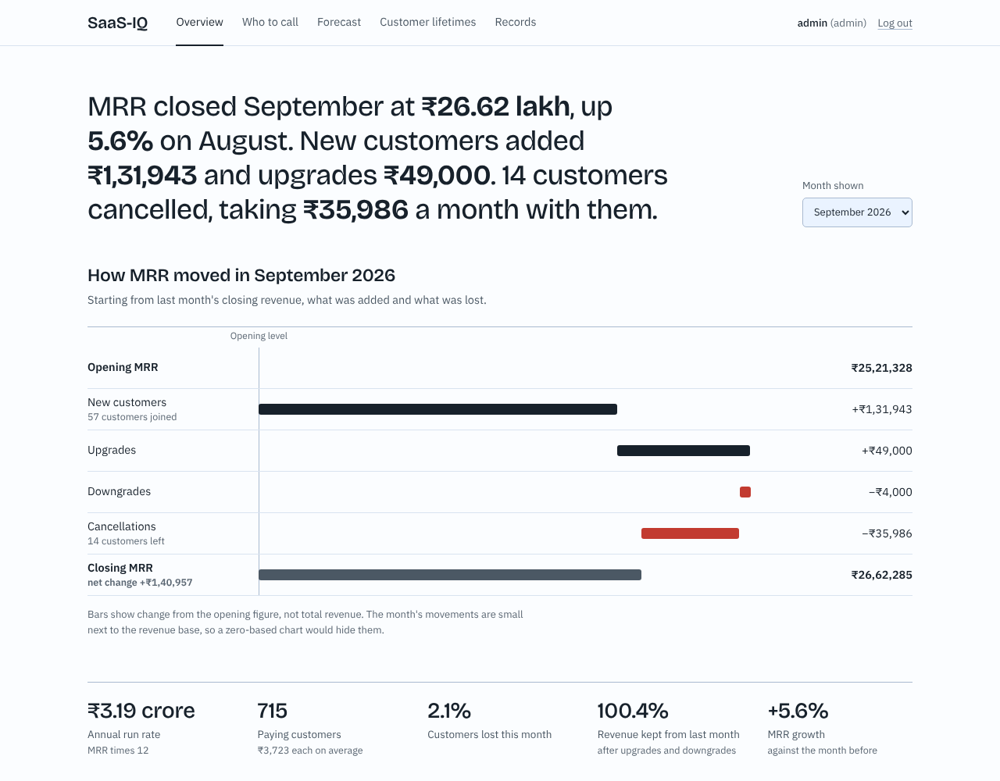

# SaaS-IQ: subscription revenue, churn and forecasting

A Flask web app for a subscription software business. It explains why monthly recurring revenue (MRR) moved, shows which acquisition channels earn their cost back, predicts which customers are about to cancel and ranks them by the value of a retention call, and forecasts the next six months of revenue.

All data is **synthetic** (generated by `data/seed_data.py`), so every number below illustrates the method and is not a real company's result.



## The problem

A revenue manager looks at one number, "MRR is ₹26 lakh", and cannot tell what is behind it. New customers can hide a leak of cancellations, and money spent on a weak channel looks the same as money spent on a good one. The manager needs answers to four questions:

1. Why did revenue move this month?
2. Which acquisition channels earn their cost back?
3. Which customers are likely to cancel, and is a call to each one worth its cost?
4. Where is revenue heading over the next six months?

## What the analysis found (on the demo data)

| Question | Finding |
|---|---|
| Why did MRR move in September 2026? | Up 5.6% to ₹26.62 lakh. New customers added ₹1.32 lakh and upgrades ₹49,000. 14 cancellations took ₹36,000 a month. |
| Where do trials end up? | 4,000 trials, 958 became paying (24%), 715 still paying. |
| Which channels pay back? | LTV:CAC of 3.6× for Organic and 3.0× for Referral. Outbound 1.1×, LinkedIn 1.0×. Google Ads 0.9×, and 7.2% of its customers cancel each month. |
| Can churn be predicted? | On later months the model never saw (1,893 customer-months, 46 real leavers): PR-AUC 0.46 against 0.02 for guessing, ROC-AUC 0.84. The riskiest tenth of customers churns 6.7× more than average and holds 67% of all leavers. |
| Who should be called? | With the stated assumptions, 15 customers. Expected cost ₹7,500, expected margin kept about ₹16,900, roughly 17× better than calling 15 random customers. |
| Where is MRR heading? | About ₹37.6 lakh by March 2027 (likely range ₹35.7 to ₹39.5 lakh). Average backtest error 5.6%, against 6.2% for a straight-line trend and 24.3% for a flat guess. |

## Pages

| Page | Who sees it | What it shows |
|---|---|---|
| **Overview** | everyone | One-sentence summary of the month, MRR bridge, trial funnel, LTV:CAC by channel, cohort retention heatmap, channel scorecard |
| **Who to call** | manager, admin | Customers ranked by the value of a call, with plain-English reasons and the model's held-out test results |
| **Forecast** | everyone | Six-month forecast with a P10 to P90 range, backtested against two baselines |
| **Customer lifetimes** | everyone | Survival curves by channel, churn alerts with a breakdown by channel |
| **Records** | admin | Delete customers; every change goes to an audit log |

There is also `GET /api/churn-risk?limit=20&min_prob=0.1` (manager and admin) and `GET /health`.

## How it works

- **MRR bridge:** new (0 to paid), upgrades and downgrades (plan change), cancellations (paid to 0). A customer who returns after a gap counts as new. A test checks opening + new + upgrades − downgrades − cancellations = closing.
- **CAC:** total channel spend divided by customers who actually paid.
- **LTV:** revenue per customer × 80% margin × expected paying months over the next 24, read from each channel's Kaplan-Meier survival curve. This handles customers who have not cancelled yet, which a plain 1 ÷ churn formula does not.
- **Churn model:** logistic regression and gradient boosting compared on validation PR-AUC, then tested once on later months. Train, validation and test periods are separated by a one-month gap so no future information leaks in. Reported against the no-skill baseline, with a risk-decile chart and permutation importance. Per-customer reasons come from one-at-a-time ablation.
- **Call list:** value of a call = chance of leaving × chance a call keeps them × margin over the months kept − cost of the call. Only customers with a positive value are listed.
- **Forecast:** next MRR = this MRR × recent revenue-retention rate + new-customer MRR from a 12-month trend, simulated 1,000 times for the range. Backtested from seven past starting points.
- **Anomalies:** robust z-scores and a p-chart on monthly churn. Flagged months are broken down by channel. A churn shock is injected into Google Ads at a known month, and a test checks the detector finds it, blames the right channel, and raises no false alarm.

## Run it

You need Python 3.10 or newer.

```bash
pip install -r requirements.txt
python -m data.seed_data     # creates the demo data and users, and trains the churn model
python run.py                # then open http://127.0.0.1:5000 and leave the terminal open
python -m pytest             # 24 tests
```

Sign in as `manager`, `analyst` or `admin`. The password for all three is `demo123`.

## Project layout

```
app/services/     metrics, survival, forecast, anomaly, retention (pure pandas, no Flask)
app/ml/           churn model training and scoring
app/routes.py     pages, role checks, JSON API
app/templates/    page templates
app/static/       CSS, JS and self-hosted fonts (the chart library is served from the plotly package, so it works offline)
data/seed_data.py synthetic data generator (fixed date and seed, so results are reproducible)
tests/            metrics, survival, forecast, anomaly, retention, permissions
docs/             screenshots used in this README
```

## Limitations

- The call-list inputs (30% of called customers kept, ₹500 per call, 6 months kept) are **assumptions**. A real team would measure them with an A/B test: call a random half of the at-risk customers and compare.
- The churn test set has only 46 leavers, so scores carry wide uncertainty. About 30% of leavers in this data show no warning signs at all.
- The forecast and the straight-line trend are roughly tied. Both clearly beat a flat guess.
- Forecast error grows with distance, and the range reflects simulated noise, not every real-world risk.
- Not yet built: CSV upload, Docker, deployment.

## About

Built with AI assistance (Claude). Fonts: IBM Plex Sans and Bricolage Grotesque (SIL Open Font License). Charts: Plotly (MIT).
